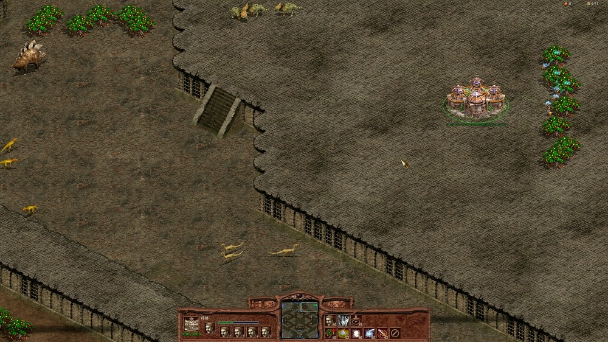

# 쥬라기원시전2: 더랭커 해상도설정

쥬라기원시전2: 더랭커를 모니터가 지원하는 해상도로 실행하게 해 주는 도구다. C# 으로 만든 Trk Resolution Settings 가 모니터의 해상도 목록을 보여 주고, 고른 해상도를 게임메이커 8로 만든 Setting.exe 에 넘긴다. Setting.exe 는 함께 들어 있는 더랭커 실행 파일 `trk.ex_` 를 복사해 화면 크기와 화면 아래 인터페이스의 좌표를 그 해상도에 맞게 고친 새 실행 파일을 만든다. 분석한 주소는 [docs/resolution-patch.ko.md](docs/resolution-patch.ko.md) 에 있다.

배포할 때 쥬라기원시전2: 더랭커 v2003.12.29 이상에서 쓰도록 안내했다.

<p>
  
</p>


## 사용 방법

Releases에서 받은 압축 파일에는 Trk Resolution Settings.exe, Setting.exe, DB.dat, trk.ex_ 가 들어 있다. 네 파일을 한 폴더에 두고 Trk Resolution Settings.exe 를 실행한다.

위 목록에서 모니터를 고르면 아래 목록에 그 모니터가 지원하는 해상도가 뜬다. Set 버튼은 주 모니터를 골랐을 때만 눌린다. 해상도를 고르고 Set 을 누르면 창이 닫히고 저장 창이 뜬다. 기본 이름은 `TheRanker 1280 x 1024.exe` 처럼 해상도가 붙은 이름이다. 더랭커가 설치된 폴더에 저장한 뒤 그 실행 파일로 게임을 시작하면 된다. 원래 실행 파일은 그대로 남는다.

800x600 을 기준으로 화면이 넓어진 만큼 인터페이스를 가로로는 가운데로, 세로로는 아래로 옮긴다.


## 구현 원리

**해상도 목록은 Win32 API 로 얻는다.** `EnumDisplayDevices` 로 디스플레이 장치를 차례로 읽고, 고른 장치의 이름으로 `EnumDisplaySettings` 를 모드 번호 0 부터 실패할 때까지 불러 `너비 x 높이` 문자열을 모은다. 주사율과 색 깊이만 다른 모드는 같은 문자열이라 한 번만 넣는다. 장치의 `StateFlags` 에 주 장치 비트(4)가 있을 때만 Set 을 켠다.

```csharp
do
{
    result = EnumDisplaySettings(devName, 
        modeNum, ref devMode);

    if (result)
    {
        string item = DevmodeToString(devMode);
        if (listSettings.FindString(item, 0)==-1)
        {
            listSettings.Items.Add(item);
        }
    }
    modeNum++;
} while (result);
```

Set 은 고른 문자열을 따옴표로 감싸 Setting.exe 의 인자로 넘긴다.

```csharp
char temps = (char)34;
System.Diagnostics.Process program = 
    System.Diagnostics.Process.Start("Setting.exe", temps.ToString() + listSettings.SelectedItem + temps.ToString());
```

**`trk.ex_` 는 해상도와 인터페이스 좌표를 데이터에서 읽도록 고쳐 둔 실행 파일이다.** 화면 너비와 높이를 정하는 `0x4D6E97` 의 코드가 `0x8635CC` 와 `0x8635C8` 의 값을 읽고, 인터페이스 좌표 표는 `ecx * 0x60 + 종족 * 0x18` 자리에서 읽히는데 그 함수가 첫머리에서 `ecx` 를 1 로 고정한다. 그래서 `ecx` 가 1 인 칸만 쓰이고, `ecx` 가 0 일 때의 첫 칸(`0x8635C8`, `0x8635CC`)이 해상도 값을 두는 자리가 된다. Setting.exe 는 `ecx` 가 1 인 칸의 좌표를 800x600 기준 값으로 놓고 옮긴다. 고친 자리는 `NOP` 으로 채운 구간으로 남아 있다.

**Setting.exe 는 복사본의 데이터만 고친다.** 인자의 `너비 x 높이` 를 숫자로 나누고, `DB.dat` 의 16진 주소를 읽은 뒤, 저장 창에서 정한 이름으로 `trk.ex_` 를 복사한다. 첫 두 주소에 너비와 높이를 쓰고, 나머지 좌표에는 `xpos = 너비 - 800` 의 절반과 `ypos = 높이 - 600` 을 더한다. 주소는 가상 주소라 파일 위치는 이미지 베이스 `0x400000` 을 빼서 구한다. 좌표 표는 `DB.dat` 의 주소마다 `0x60 + 0x18 * 종족` 을 더한 자리, 곧 `ecx` 가 1 인 네 종족 칸이다. 앞 줄이 y, 뒤 줄이 x 다.

```gml
for(i=0; i!=4; i+=1)
{
    int = (24*i)+96-4194304
    for(j=0; j!=ds_list_size(db); j+=1)
    {
        file_bin_seek(file, ds_list_find_value(db, j)+int)
        int2 = file_bin_read_int(file)
        file_bin_seek(file, ds_list_find_value(db, j)+int)
        if(j mod 2){
            file_bin_write_int(file, int2+round(xpos/2))
        }
        else{
            file_bin_write_int(file, int2+ypos)
        }
    }
}
```

`DB.dat` 에 없는 좌표 표는 주소를 코드에 바로 적어 같은 방식으로 `ecx` 가 1 인 칸의 x 와 y 를 옮긴다. 게임메이커 8의 `file_bin_*` 함수는 바이트 단위라 4바이트 정수는 `file_bin_read_int`, `file_bin_write_int` 스크립트에서 리틀 엔디언으로 묶고 푼다.


## 파일

| 경로 | 내용 |
|---|---|
| `source/Trk Resolution Settings/` | Trk Resolution Settings 의 Visual Studio 솔루션 (C#, .NET Framework 4.5) |
| `source/Setting.gmk` | Setting.exe 의 게임메이커 8 프로젝트 파일 |
| `source/split/` | GmkSplitter로 분해한 텍스트 트리 |
| `docs/resolution-patch.ko.md` | 해상도와 인터페이스 좌표 주소 |
| `docs/screenshots/` | 스크린샷 |
| Releases | Trk Resolution Settings.exe, Setting.exe, DB.dat, trk.ex_ 와 사용 설명 |


## 크레딧

Trk Resolution Settings 의 디스플레이 장치와 해상도 열거 코드(`DISPLAY_DEVICE`, `DEVMODE` 구조체, `EnumDevices`, `EnumModes`, `GetDeviceName`, `MainDevice` 와 `user32.dll` 선언)는 news2news.com(Anatoliy Mogylevets) 의 예제 374 를 가져다 썼다.


## 라이선스

zlib 라이선스다. 자세한 내용은 [LICENSE](LICENSE) 에 있다. 함께 들어 있는 것 중 다른 사람이 만든 라이브러리는 각자의 라이선스를 따른다.
